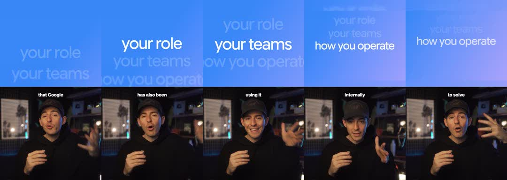

# v06_s31 · split_graphic · 54.2–56.9s (calidad 2)

- **Guion:** has also been using it internally to solve
- **Qué se ve:** Arriba: fondo azul degradado con las líneas «your role», «your teams», «how you operate» subiendo.
- **Diseño:** Sans regular blanca grande sobre azul (#3B82F6 aprox.) con degradado a violeta. Subtítulo blanco sans bold (tipo Inter), 1–3 palabras, ~30 px sobre 720 (≈2,3 % del alto), centrado, y≈52,7 % (≈58 px bajo la costura, que está en y≈48,1 %); sin caja
- **Efectos:** Set oscuro con luces cian y ámbar desenfocadas; sin textura añadida
- **Animación:** Corte seco; scroll vertical de líneas con fundido
- **Por qué aquí:** «Google has also been using it internally» → material corporativo de Google como telón
