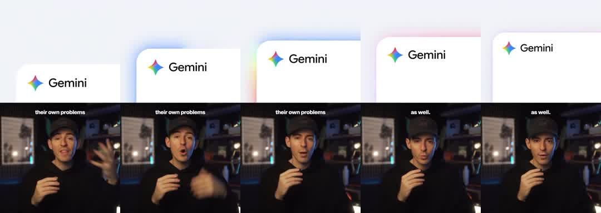

# v06_s32 · split_graphic · 56.9–58.5s (calidad 2)

- **Guion:** their own problems as well.
- **Qué se ve:** Arriba: tarjeta blanca con el logo «Gemini» que sube desde abajo con halo arcoíris.
- **Diseño:** Subtítulo blanco sans bold (tipo Inter), 1–3 palabras, ~30 px sobre 720 (≈2,3 % del alto), centrado, y≈52,7 % (≈58 px bajo la costura, que está en y≈48,1 %); sin caja
- **Efectos:** Halo arcoíris suave en el borde de la tarjeta
- **Animación:** Corte seco; la tarjeta sube en ~0,5 s
- **Por qué aquí:** «Their own problems» → logo como sujeto
