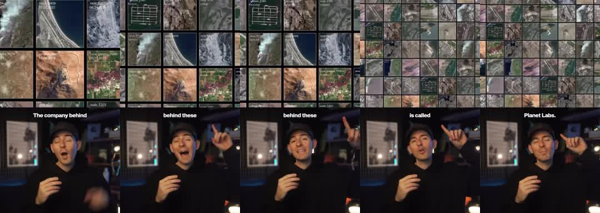

# v07_s06 · split_graphic · 8.3–9.8s (calidad 3)

- **Guion:** company behind these is called Planet
- **Qué se ve:** Arriba: mosaico de imágenes satelitales en cuadrícula con separaciones negras; la cuadrícula se aleja (de 3×3 a decenas de teselas).
- **Diseño:** Subtítulo blanco sans bold (tipo Inter), 1–3 palabras, ~28 px sobre 720, centrado, y≈54 % (≈48 px bajo la costura, que está en y≈50,4 %); sin caja sobre el A-roll
- **Efectos:** Set oscuro con luces cian y ámbar desenfocadas; sin textura añadida
- **Animación:** Corte seco; zoom-out en 3 escalones por corte
- **Por qué aquí:** «The company behind these» → volumen de imágenes = empresa de datos
