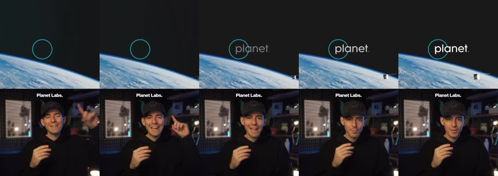

# v07_s07 · split_graphic · 9.8–10.9s (calidad 3)

- **Guion:** Labs.
- **Qué se ve:** Arriba: horizonte de la Tierra y el logotipo «planet.» con un círculo turquesa que aparece.
- **Diseño:** Logo «planet.» en sans fina blanca con círculo turquesa (#2DB5B0 aprox.), centrado en la mitad superior. Subtítulo blanco sans bold (tipo Inter), 1–3 palabras, ~28 px sobre 720, centrado, y≈54 % (≈48 px bajo la costura, que está en y≈50,4 %); sin caja sobre el A-roll
- **Efectos:** Set oscuro con luces cian y ámbar desenfocadas; sin textura añadida
- **Animación:** Corte seco; el logo se funde en ~0,4 s justo en «Planet Labs»
- **Por qué aquí:** Nombra la empresa → su logo
