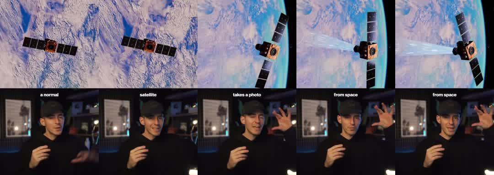

# v07_s10 · split_graphic · 13.9–15.9s (calidad 4)

- **Guion:** See, a normal satellite takes a photo from space
- **Qué se ve:** Arriba: animación 3D de un satélite dorado con paneles sobre la Tierra; emite un cono de luz azul (toma la foto).
- **Diseño:** Subtítulo blanco sans bold (tipo Inter), 1–3 palabras, ~28 px sobre 720, centrado, y≈54 % (≈48 px bajo la costura, que está en y≈50,4 %); sin caja sobre el A-roll
- **Efectos:** Set oscuro con luces cian y ámbar desenfocadas; sin textura añadida
- **Animación:** Corte seco; corte interno suave a 14.72
- **Por qué aquí:** Explicación paso 1 («a normal satellite takes a photo») → diagrama animado
