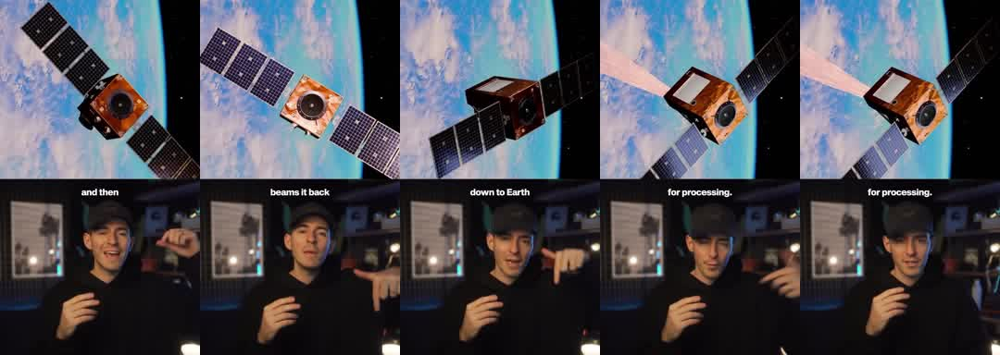

# v07_s11 · split_graphic · 15.9–18.8s (calidad 4)

- **Guion:** and then beams it back down to Earth for processing.
- **Qué se ve:** Arriba: el mismo satélite desde otros ángulos; lanza un haz rosado hacia la Tierra.
- **Diseño:** Subtítulo blanco sans bold (tipo Inter), 1–3 palabras, ~28 px sobre 720, centrado, y≈54 % (≈48 px bajo la costura, que está en y≈50,4 %); sin caja sobre el A-roll
- **Efectos:** Set oscuro con luces cian y ámbar desenfocadas; sin textura añadida
- **Animación:** Corte seco de entrada y salida (1 fotograma)
- **Por qué aquí:** Paso 2 («beams it back down to Earth for processing») → el haz baja al decir «down»
