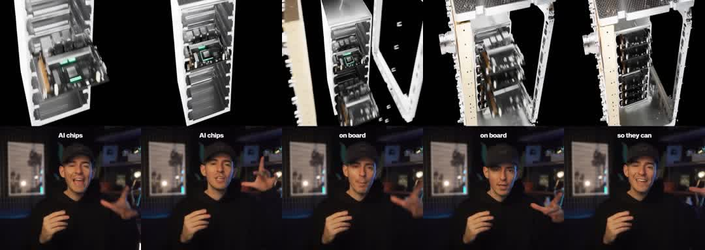

# v07_s13 · split_graphic · 20.0–21.8s (calidad 4)

- **Guion:** chips on board so they can
- **Qué se ve:** Arriba: corte 3D blanco del interior del satélite sobre negro, girando rápido (placas y módulos).
- **Diseño:** Subtítulo blanco sans bold (tipo Inter), 1–3 palabras, ~28 px sobre 720, centrado, y≈54 % (≈48 px bajo la costura, que está en y≈50,4 %); sin caja sobre el A-roll
- **Efectos:** Blanco puro sobre negro
- **Animación:** Corte seco de entrada y salida (1 fotograma)
- **Por qué aquí:** «AI chips on board» → se abre el satélite y se ve el interior
