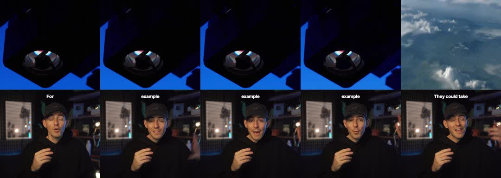

# v07_s17 · split_graphic · 26.5–27.0s (calidad 2)

- **Guion:** For example, they
- **Qué se ve:** Arriba: gráfico azul eléctrico y negro de la lente del satélite (0,5 s).
- **Diseño:** Subtítulo blanco sans bold (tipo Inter), 1–3 palabras, ~28 px sobre 720, centrado, y≈54 % (≈48 px bajo la costura, que está en y≈50,4 %); sin caja sobre el A-roll
- **Efectos:** Azul saturado plano (#1F5BFF aprox.) sobre negro
- **Animación:** Corte seco de entrada y salida (1 fotograma)
- **Por qué aquí:** «For example» → medio segundo de cortinilla gráfica
