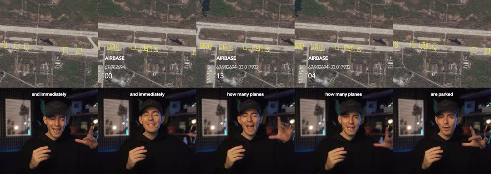

# v07_s19 · split_graphic · 29.3–32.4s (calidad 5)

- **Guion:** immediately identify how many planes are parked in
- **Qué se ve:** Arriba: base aérea vista desde arriba; recuadros amarillos aparecen sobre los aviones y un rótulo «AIRBASE · 67.982694, 33.017932» con un contador que sube (03 → 11…).
- **Diseño:** Recuadros amarillos (#FFE600 aprox.) de trazo fino; HUD en sans blanca: «AIRBASE» bold, coordenadas light, contador grande. Subtítulo blanco sans bold (tipo Inter), 1–3 palabras, ~28 px sobre 720, centrado, y≈54 % (≈48 px bajo la costura, que está en y≈50,4 %); sin caja sobre el A-roll
- **Efectos:** Set oscuro con luces cian y ámbar desenfocadas; sin textura añadida
- **Animación:** Corte seco; recuadros aparecen de izquierda a derecha entre 29.4 y 31.0; el contador cambia cada pocos fotogramas
- **Por qué aquí:** «Identify how many planes are parked» → se cuenta en pantalla: la IA trabajando
