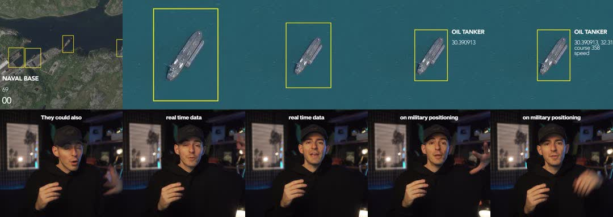

# v07_s21 · split_graphic · 33.3–35.9s (calidad 5)

- **Guion:** They could also collect real -time data on military positioning,
- **Qué se ve:** Arriba: «NAVAL BASE · 69.215410, 33.345 · 02» con recuadros sobre barcos (33.33–33.9); luego un petrolero en mar turquesa con recuadro amarillo y datos «OIL TANKER · course 358 · speed 8.7 · heading 280».
- **Diseño:** Mismo sistema HUD amarillo/blanco; datos en sans light pequeña a la derecha del recuadro. Subtítulo blanco sans bold (tipo Inter), 1–3 palabras, ~28 px sobre 720, centrado, y≈54 % (≈48 px bajo la costura, que está en y≈50,4 %); sin caja sobre el A-roll
- **Efectos:** Set oscuro con luces cian y ámbar desenfocadas; sin textura añadida
- **Animación:** Corte seco; las líneas de datos se escriben una a una (34.3–35.6)
- **Por qué aquí:** «Real-time data on military positioning» → ficha de datos de un barco
