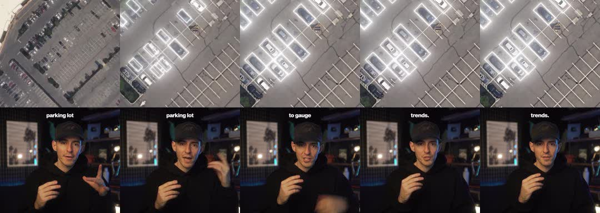

# v07_s23 · split_graphic · 38.4–40.2s (calidad 4)

- **Guion:** lot to gauge shopping trends.
- **Qué se ve:** Arriba: aparcamiento con recuadros blancos brillantes sobre cada coche.
- **Diseño:** Subtítulo blanco sans bold (tipo Inter), 1–3 palabras, ~28 px sobre 720, centrado, y≈54 % (≈48 px bajo la costura, que está en y≈50,4 %); sin caja sobre el A-roll
- **Efectos:** Glow blanco en recuadros
- **Animación:** Continuación del zoom; los recuadros aparecen en ≈38.6–39.0
- **Por qué aquí:** «To gauge shopping trends» → conteo de coches
