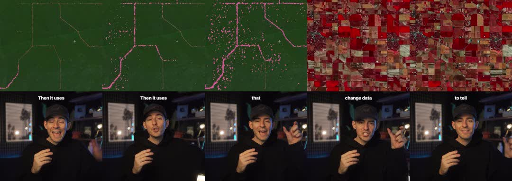

# v07_s30 · split_graphic · 53.0–55.1s (calidad 4)

- **Guion:** Then it uses that change data to tell
- **Qué se ve:** Arriba: mapa verde donde aparecen puntos y líneas rosas (53.01–≈53.8) y luego campos en falso color rojo (≈53.8–55.06).
- **Diseño:** Subtítulo blanco sans bold (tipo Inter), 1–3 palabras, ~28 px sobre 720, centrado, y≈54 % (≈48 px bajo la costura, que está en y≈50,4 %); sin caja sobre el A-roll
- **Efectos:** Falso color infrarrojo (rojo saturado)
- **Animación:** Corte seco de entrada; puntos rosas aparecen progresivamente
- **Por qué aquí:** «Uses that change data» → los cambios marcados en rosa/rojo
