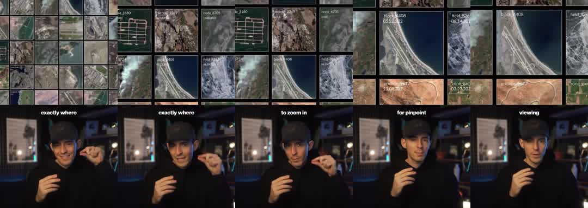

# v07_s32 · split_graphic · 56.3–58.9s (calidad 4)

- **Guion:** where to zoom in for pinpoint viewing.
- **Qué se ve:** Arriba: cuadrícula de teselas etiquetadas («node_2180», «block_4408 05.22.2022», «field_826»); zoom a una tesela (57.93).
- **Diseño:** Teselas con borde fino y etiquetas mono-espaciadas claras. Subtítulo blanco sans bold (tipo Inter), 1–3 palabras, ~28 px sobre 720, centrado, y≈54 % (≈48 px bajo la costura, que está en y≈50,4 %); sin caja sobre el A-roll
- **Efectos:** Set oscuro con luces cian y ámbar desenfocadas; sin textura añadida
- **Animación:** Corte seco; zoom-in en 2 saltos
- **Por qué aquí:** «Exactly where to zoom in for pinpoint viewing» → zoom a una tesela
