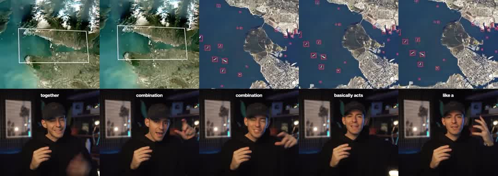

# v07_s33 · split_graphic · 58.9–61.2s (calidad 4)

- **Guion:** Together, that combination basically acts like a
- **Qué se ve:** Arriba: imagen costera con un rectángulo blanco (58.93–59.81) y, tras el zoom, un puerto con recuadros rojos sobre barcos (59.81–61.19).
- **Diseño:** Subtítulo blanco sans bold (tipo Inter), 1–3 palabras, ~28 px sobre 720, centrado, y≈54 % (≈48 px bajo la costura, que está en y≈50,4 %); sin caja sobre el A-roll
- **Efectos:** Set oscuro con luces cian y ámbar desenfocadas; sin textura añadida
- **Animación:** Corte seco; zoom por corte a 59.81
- **Por qué aquí:** «That combination» → gran angular (rectángulo) + detalle (recuadros) en un solo gesto
