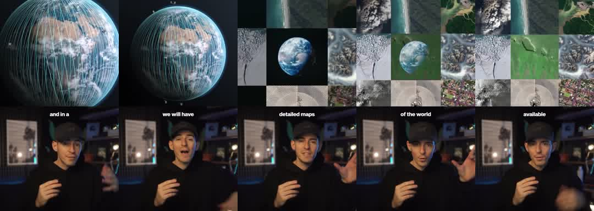

# v07_s39 · split_graphic · 75.9–79.9s (calidad 4)

- **Guion:** And in a few years, we will have real -time detailed maps of the world available in
- **Qué se ve:** Arriba: globo con líneas de órbita (75.87–77.08) y luego la Tierra en el centro con teselas que van rellenando un mosaico alrededor (77.08–79.91).
- **Diseño:** Subtítulo blanco sans bold (tipo Inter), 1–3 palabras, ~28 px sobre 720, centrado, y≈54 % (≈48 px bajo la costura, que está en y≈50,4 %); sin caja sobre el A-roll
- **Efectos:** Set oscuro con luces cian y ámbar desenfocadas; sin textura añadida
- **Animación:** Corte seco; las teselas entran en cadena durante ~2,5 s
- **Por qué aquí:** «Real-time detailed maps of the world» → el mapa completándose
