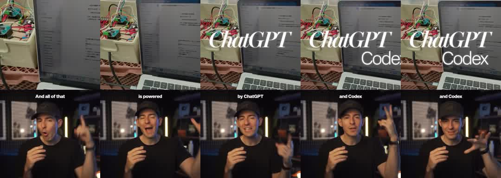

# v09_s21 · split_graphic · 41.0–43.8s (calidad 5)

- **Guion:** And all of that is powered by chat GPT and codecs that
- **Qué se ve:** Arriba b-roll de portátil con cableado y, encima, 'ChatGPT' en serif itálica enorme y 'Codex' en sans fina debajo, apareciendo con cada palabra.
- **Diseño:** Split 50/50. Sobre el b-roll: 'ChatGPT' en serif itálica blanca ≈95 px de alto (≈85 % del ancho) en y≈8–16 %; 'Codex' en sans light/regular blanca ≈60 px alineada a la derecha debajo (y≈17–24 %). Subtítulo pequeño bajo la costura.
- **Efectos:** Sin grano, papel ni halftone añadidos. A-roll: set oscuro, viñeta natural, prácticos cálidos y tubo/luz cian al fondo. Mitad superior sin filtros: el material conserva su color original (contraste fuerte con el set oscuro de abajo).
- **Animación:** Corte seco al b-roll en 41.00; 'ChatGPT' aparece en ≈42.1 y 'Codex' en ≈43.1, cada uno por pop con su palabra; salen por corte seco en 43.75.
- **Por qué aquí:** Nombra las herramientas (el 'quién lo hace posible'): marca como titular tipográfico, no logo.
