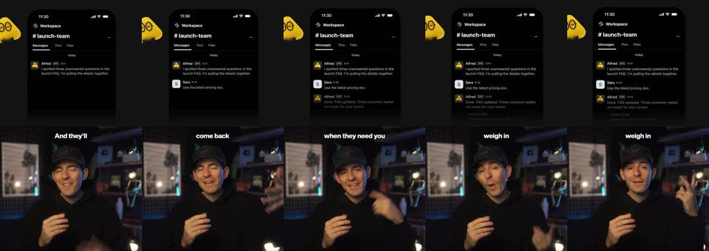

# v10_s22 · split_graphic · 44.6–46.4s (calidad 3)

- **Guion:** And they'll come back to you when they need you to weigh in or
- **Qué se ve:** Arriba móvil oscuro '# launch-team' con mensajes de Alfred y Sara; mascota asomando a la izquierda.
- **Diseño:** Split 50/50: gráfico/motion diseñado a sangre arriba. Subtítulo: sans geométrica bold blanca, minúsculas con puntuación, ≈30 px de alto de letra sobre 720 px de ancho, centrado en x, 1–3 palabras, bajo la costura (y≈54 %).
- **Efectos:** Sin grano, papel ni halftone añadidos. A-roll: set oscuro, viñeta natural, prácticos cálidos y tubo/luz cian al fondo. Mitad superior sin filtros: el material conserva su color original (contraste fuerte con el set oscuro de abajo).
- **Animación:** La mitad superior entra por corte seco (1 fotograma) sincronizada con la palabra; los cambios internos también son cortes secos; el único movimiento es el propio del material (cámara del clip, scroll o zoom lento). La mitad inferior no corta (toma continua). Subtítulo por sustitución instantánea cada 1–3 palabras.
- **Por qué aquí:** 'they'll come back to you when they need you': el agente te escribe en tu canal.
