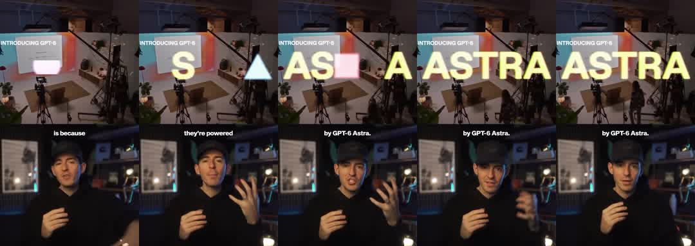

# v10_s32 · split_graphic · 70.5–73.2s (calidad 5)

- **Guion:** because they're powered by GPT-6 Astra.
- **Qué se ve:** Arriba plató de rodaje con rótulo 'INTRODUCING GPT-6' y letras gigantes 'ASTRA' amarillo pálido formándose a partir de formas (círculo, triángulo, cuadrado).
- **Diseño:** Split 50/50: gráfico/motion diseñado a sangre arriba. Subtítulo: sans geométrica bold blanca, minúsculas con puntuación, ≈30 px de alto de letra sobre 720 px de ancho, centrado en x, 1–3 palabras, bajo la costura (y≈54 %).
- **Efectos:** Sin grano, papel ni halftone añadidos. A-roll: set oscuro, viñeta natural, prácticos cálidos y tubo/luz cian al fondo. Mitad superior sin filtros: el material conserva su color original (contraste fuerte con el set oscuro de abajo).
- **Animación:** La mitad superior entra por corte seco (1 fotograma) sincronizada con la palabra; los cambios internos también son cortes secos; el único movimiento es el propio del material (cámara del clip, scroll o zoom lento). La mitad inferior no corta (toma continua). Subtítulo por sustitución instantánea cada 1–3 palabras.
- **Por qué aquí:** Nombre del modelo = imagen de marca oficial; da autoridad al dato 'powered by GPT-6 Astra'.
