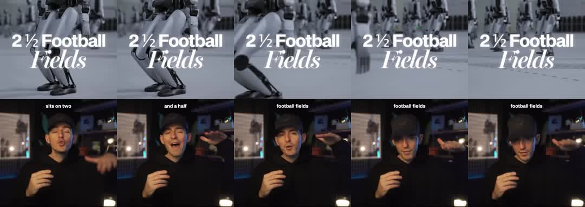

# v12_s12 · split_graphic · 24.9–26.5s (calidad 5)

- **Guion:** and a half football fields of
- **Qué se ve:** Arriba b-roll desaturado de piernas de robot con el rótulo '2 ½ Football' (sans bold) + 'Fields' (serif itálica) en blanco.
- **Diseño:** Split 48/52. Rótulo blanco centrado en la mitad superior (y≈8–18 %): '2 ½ Football' en sans grotesca bold ≈60 px (fracción ½ tipográfica) y debajo 'Fields' en serif itálica de alto contraste ≈70 px. Subtítulo pequeño bajo la costura repite 'and a half / football fields'.
- **Efectos:** Sin grano, papel ni halftone añadidos. A-roll: set oscuro, viñeta natural, prácticos cálidos y tubo/luz cian al fondo. Mitad superior sin filtros: el material conserva su color original (contraste fuerte con el set oscuro de abajo).
- **Animación:** Corte seco al b-roll; el rótulo aparece ≈0.15 s después (ya completo en 25.1, sincronizado con 'two and a half football fields'), sin fade apreciable; sale por corte en 26.48.
- **Por qué aquí:** Dato de escala convertido en titular bi-tipográfico (sans + itálica): el número es lo memorable.
