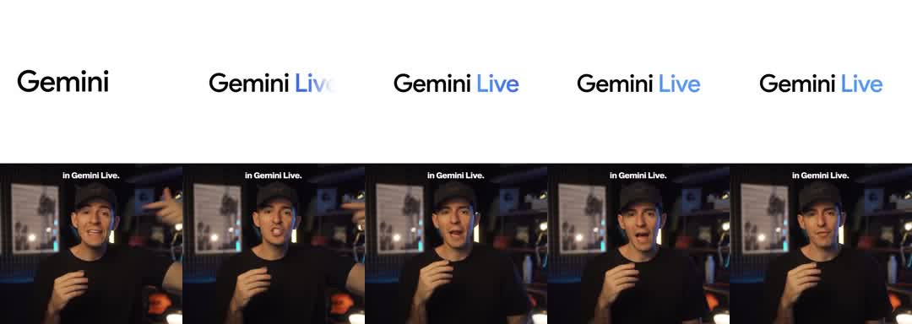

# v13_s02 · split_graphic · 3.3–4.5s (calidad 4)

- **Guion:** Gemini Live.
- **Qué se ve:** Arriba tarjeta blanca con el logotipo «Gemini Live» («Gemini» negro, «Live» en degradado azul). Abajo él; subtítulo «in Gemini Live.».
- **Diseño:** Pantalla dividida: evidencia arriba (0–50 %), él abajo en set oscuro (gorra y camiseta negras, luces naranja/cian desenfocadas). Costura recta sin borde en y≈645 px de 1280 (50,4 %). Subtítulo: sans geométrica bold blanca (tipo Inter/Helvetica Now Bold), minúsculas con mayúscula inicial de frase, ~30 px de alto de fuente sobre 720 px de ancho, 1–3 palabras, centrado en x, sombra negra suave. Subtítulo en y≈693 px (54 %), justo bajo la costura, sobre su gorra. Arriba: motion graphic diseñado.
- **Efectos:** Degradado suave magenta→azul o blanco limpio; sombras suaves bajo tarjetas.
- **Animación:** Elementos entran con pop (escala+blur, ~5 fotogramas) o write-on; corte seco al salir.
- **Por qué aquí:** Nombra el producto → logo. Además el blanco tras el negro funciona como flash visual que cierra el gancho.
