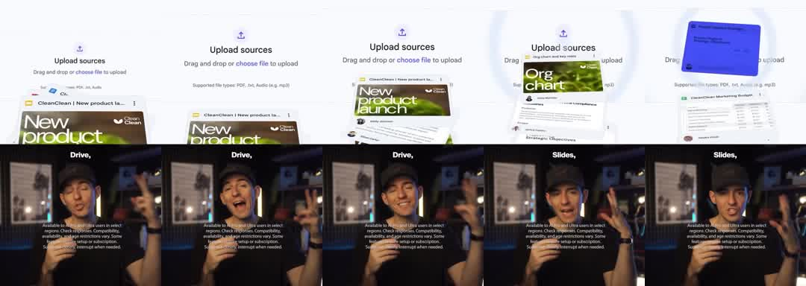

# v13_s10 · split_graphic · 15.4–16.8s (calidad 4)

- **Guion:** drives, slidesheets,
- **Qué se ve:** Arriba una interfaz clara «Upload sources — Drag and drop or choose file to upload» sobre la que caen tarjetas de archivos (presentación «New product launch», «Org chart», diapositiva azul, hoja de presupuesto). Subtítulo «Drive,» y luego «Slides,».
- **Diseño:** Pantalla dividida: evidencia arriba (0–50 %), él abajo en set oscuro (gorra y camiseta negras, luces naranja/cian desenfocadas). Costura recta sin borde en y≈645 px de 1280 (50,4 %). Subtítulo: sans geométrica bold blanca (tipo Inter/Helvetica Now Bold), minúsculas con mayúscula inicial de frase, ~30 px de alto de fuente sobre 720 px de ancho, 1–3 palabras, centrado en x, sombra negra suave. Subtítulo en y≈693 px (54 %), justo bajo la costura, sobre su gorra. Arriba: motion graphic diseñado.
- **Efectos:** Degradado suave magenta→azul o blanco limpio; sombras suaves bajo tarjetas.
- **Animación:** Elementos entran con pop (escala+blur, ~5 fotogramas) o write-on; corte seco al salir.
- **Por qué aquí:** «Drive, Slides»: archivos volando = acceso a todos tus ficheros; mantiene el ritmo de lista.
