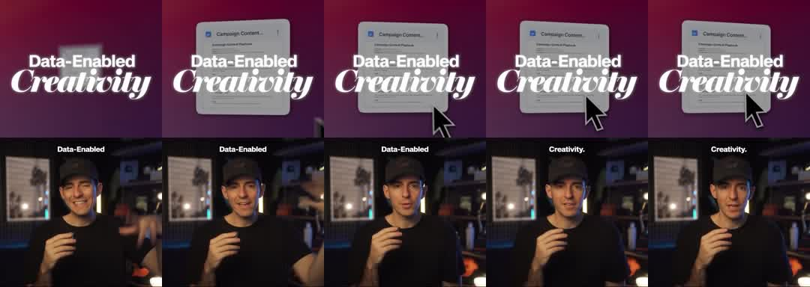

# v13_s30 · split_graphic · 62.6–64.0s (calidad 5)

- **Guion:** enabled creativity.
- **Qué se ve:** Arriba título sobre degradado morado: «Data-Enabled» (sans bold blanca) y debajo «Creativity» (serif itálica blanca grande), con la tarjeta del doc desenfocada detrás y el cursor. Abajo él; subtítulo «Data-Enabled», «Creativity.».
- **Diseño:** Pantalla dividida: evidencia arriba (0–50 %), él abajo en set oscuro (gorra y camiseta negras, luces naranja/cian desenfocadas). Costura recta sin borde en y≈645 px de 1280 (50,4 %). Subtítulo: sans geométrica bold blanca (tipo Inter/Helvetica Now Bold), minúsculas con mayúscula inicial de frase, ~30 px de alto de fuente sobre 720 px de ancho, 1–3 palabras, centrado en x, sombra negra suave. Subtítulo en y≈693 px (54 %), justo bajo la costura, sobre su gorra. Arriba: motion graphic diseñado.
- **Efectos:** Degradado suave magenta→azul o blanco limpio; sombras suaves bajo tarjetas.
- **Animación:** Elementos entran con pop (escala+blur, ~5 fotogramas) o write-on; corte seco al salir.
- **Por qué aquí:** Bautiza el método: un nombre propio merece un rótulo propio (concepto memorizable).
