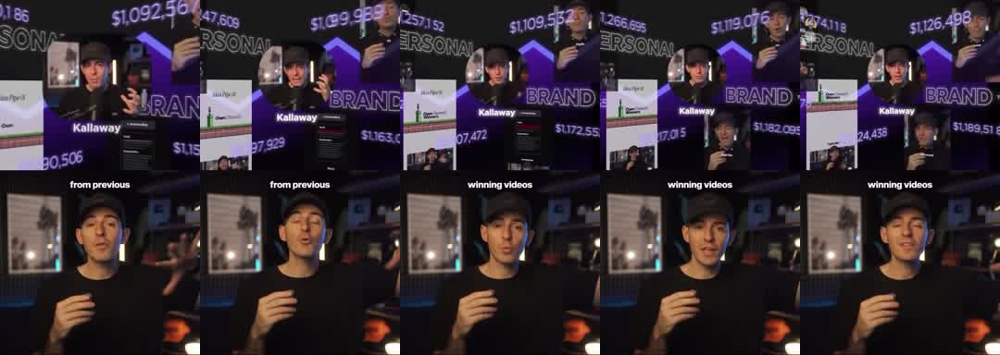

# v13_s32 · split_graphic · 65.6–67.1s (calidad 4)

- **Guion:** previous winning videos to
- **Qué se ve:** Arriba collage animado de miniaturas de sus videos con cifras moradas de neón («$1,093,62…», «$1,182,095»), rótulos «PERSONAL», «BRAND» y un círculo con su cara y la etiqueta «Kallaway». Subtítulo «from previous», «winning videos».
- **Diseño:** Pantalla dividida: evidencia arriba (0–50 %), él abajo en set oscuro (gorra y camiseta negras, luces naranja/cian desenfocadas). Costura recta sin borde en y≈645 px de 1280 (50,4 %). Subtítulo: sans geométrica bold blanca (tipo Inter/Helvetica Now Bold), minúsculas con mayúscula inicial de frase, ~30 px de alto de fuente sobre 720 px de ancho, 1–3 palabras, centrado en x, sombra negra suave. Subtítulo en y≈693 px (54 %), justo bajo la costura, sobre su gorra. Arriba: motion graphic diseñado.
- **Efectos:** Degradado suave magenta→azul o blanco limpio; sombras suaves bajo tarjetas.
- **Animación:** Elementos entran con pop (escala+blur, ~5 fotogramas) o write-on; corte seco al salir.
- **Por qué aquí:** «videos ganadores anteriores» → sus propios videos con números creciendo.
