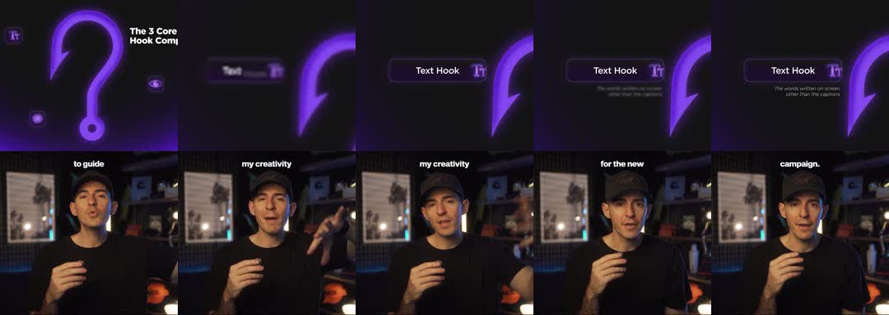

# v13_s33 · split_graphic · 67.1–69.7s (calidad 3)

- **Guion:** guide my creativity for the new campaign.
- **Qué se ve:** Arriba gráfico morado de neón: un gancho con forma de signo de interrogación y «The 3 Core Hook Comp…», luego una pastilla «Text Hook» con ícono Tt y una flecha morada curva. Subtítulos «to guide», «my creativity», «for the new», «campaign.».
- **Diseño:** Pantalla dividida: evidencia arriba (0–50 %), él abajo en set oscuro (gorra y camiseta negras, luces naranja/cian desenfocadas). Costura recta sin borde en y≈645 px de 1280 (50,4 %). Subtítulo: sans geométrica bold blanca (tipo Inter/Helvetica Now Bold), minúsculas con mayúscula inicial de frase, ~30 px de alto de fuente sobre 720 px de ancho, 1–3 palabras, centrado en x, sombra negra suave. Subtítulo en y≈693 px (54 %), justo bajo la costura, sobre su gorra. Arriba: motion graphic diseñado.
- **Efectos:** Degradado suave magenta→azul o blanco limpio; sombras suaves bajo tarjetas.
- **Animación:** Elementos entran con pop (escala+blur, ~5 fotogramas) o write-on; corte seco al salir.
- **Por qué aquí:** Ejemplo de «formatos que funcionaron»: reutiliza gráficos de sus propios videos como evidencia.
