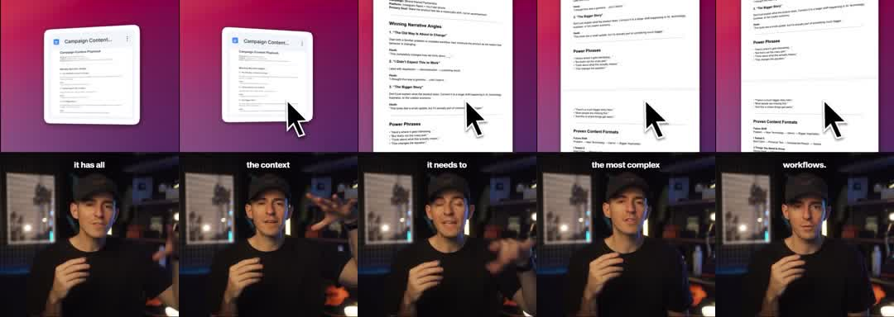

# v13_s49 · split_graphic · 104.3–108.9s (calidad 3)

- **Guion:** it has all the context and resources it needs to build out the most complex workflows.
- **Qué se ve:** Arriba degradado magenta con la tarjeta del doc «Campaign Content…» que hace pop, cursor que la abre (105,6 s) y página blanca que hace scroll (Winning Narrative Angles, Power Phrases, Proven Content Formats). Abajo él. Subtítulos «it has all», «the context», «and resources», «it needs to», «build out», «the most complex», «workflows.».
- **Diseño:** Pantalla dividida: evidencia arriba (0–50 %), él abajo en set oscuro (gorra y camiseta negras, luces naranja/cian desenfocadas). Costura recta sin borde en y≈645 px de 1280 (50,4 %). Subtítulo: sans geométrica bold blanca (tipo Inter/Helvetica Now Bold), minúsculas con mayúscula inicial de frase, ~30 px de alto de fuente sobre 720 px de ancho, 1–3 palabras, centrado en x, sombra negra suave. Subtítulo en y≈693 px (54 %), justo bajo la costura, sobre su gorra. Arriba: motion graphic diseñado.
- **Efectos:** Degradado suave magenta→azul o blanco limpio; sombras suaves bajo tarjetas.
- **Animación:** Elementos entran con pop (escala+blur, ~5 fotogramas) o write-on; corte seco al salir.
- **Por qué aquí:** Recuerda el entregable mientras resume el beneficio.
