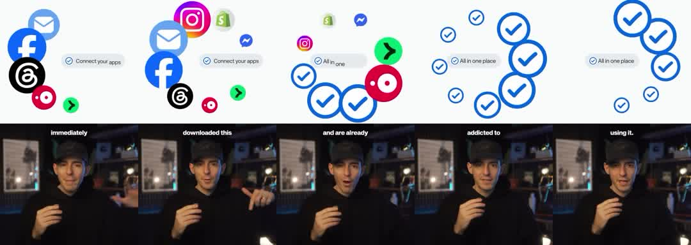

# v14_s25 · split_graphic · 38.2–41.2s (calidad 3)

- **Guion:** immediately downloaded this and are already addicted to using it.
- **Qué se ve:** Arriba fondo blanco con íconos de apps (Threads, Facebook, Instagram, correo, Messenger, Shopify) alrededor de una pastilla «Connect your apps»; se transforman en círculos azules con check y la pastilla dice «All in one place». Subtítulos «immediately», «downloaded this», «and are already», «addicted to», «using it.».
- **Diseño:** Pantalla dividida: evidencia arriba, él abajo en set oscuro (gorra y sudadera con capucha negras, bokeh cálido y cian). Costura recta sin borde en y=646 px de 1280 (50,5 %). Subtítulo: sans bold blanca (tipo Inter/Helvetica Now Bold) ~30 px de alto de fuente sobre 720 px de ancho, 1–3 palabras, centrado en x, sombra negra suave. Subtítulo en y≈693 px (54 %), justo bajo la costura. Arriba: motion graphic de producto (render 3D, logo o animación de marca).
- **Efectos:** Fondos limpios: negro (render), blanco (UI), azul cielo.
- **Animación:** Animación propia del gráfico (rotación 3D, pop de íconos, texto que aparece); corte seco.
- **Por qué aquí:** Explica por qué engancha: todo conectado.
