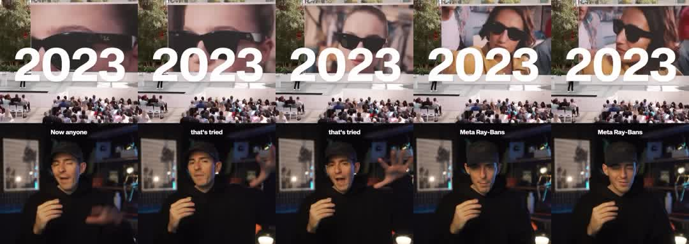

# v14_s41 · split_graphic · 71.6–73.4s (calidad 4)

- **Guion:** Now anyone that's tried Meta Ray Bands knows
- **Qué se ve:** Arriba keynote al aire libre con una pantalla gigante de caras con gafas de sol (cambia en 72,79 s) y el número «2023» enorme en blanco superpuesto. Subtítulos «Now anyone», «that's tried», «Meta Ray-Bans».
- **Diseño:** Pantalla dividida: evidencia arriba, él abajo en set oscuro (gorra y sudadera con capucha negras, bokeh cálido y cian). Costura recta sin borde en y=646 px de 1280 (50,5 %). Subtítulo: sans bold blanca (tipo Inter/Helvetica Now Bold) ~30 px de alto de fuente sobre 720 px de ancho, 1–3 palabras, centrado en x, sombra negra suave. Subtítulo en y≈693 px (54 %), justo bajo la costura. Arriba: motion graphic de producto (render 3D, logo o animación de marca).
- **Efectos:** Fondos limpios: negro (render), blanco (UI), azul cielo.
- **Animación:** Animación propia del gráfico (rotación 3D, pop de íconos, texto que aparece); corte seco.
- **Por qué aquí:** Marca que es material antiguo: fecha grande = contexto histórico.
