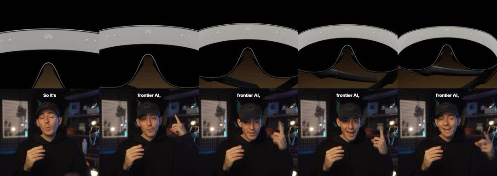

# v14_s49 · split_graphic · 86.1–87.5s (calidad 3)

- **Guion:** So it's Frontier AI,
- **Qué se ve:** Arriba render 3D del visor sobre negro. Subtítulos «So it's», «frontier AI,».
- **Diseño:** Pantalla dividida: evidencia arriba, él abajo en set oscuro (gorra y sudadera con capucha negras, bokeh cálido y cian). Costura recta sin borde en y=646 px de 1280 (50,5 %). Subtítulo: sans bold blanca (tipo Inter/Helvetica Now Bold) ~30 px de alto de fuente sobre 720 px de ancho, 1–3 palabras, centrado en x, sombra negra suave. Subtítulo en y≈693 px (54 %), justo bajo la costura. Arriba: motion graphic de producto (render 3D, logo o animación de marca).
- **Efectos:** Fondos limpios: negro (render), blanco (UI), azul cielo.
- **Animación:** Animación propia del gráfico (rotación 3D, pop de íconos, texto que aparece); corte seco.
- **Por qué aquí:** Recapitulación 1/4.
