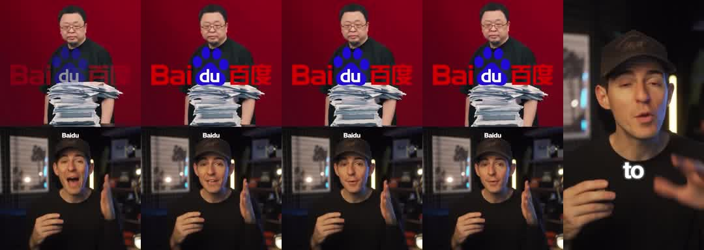

# v15_s22 · split_graphic · 24.2–24.8s (calidad 3)

- **Guion:** to
- **Qué se ve:** Arriba el presentador tras una pila de papeles con el logotipo de Baidu (letras rojas + huella azul) superpuesto. Subtítulo «Baidu».
- **Diseño:** Pantalla dividida: evidencia arriba, él abajo en set oscuro (gorra y camiseta negras, tubo de luz cálida a la derecha). Costura recta sin borde en y=649 px de 1280 (50,7 %). Subtítulo: sans bold blanca (tipo Inter/Helvetica Now Bold) ~30 px de alto de fuente sobre 720 px de ancho, 1–3 palabras, centrado en x, sombra negra suave. Subtítulo en y≈693 px (54 %), justo bajo la costura. Arriba: clip oscurecido con rótulo grande superpuesto en sans EXTENDIDA ultra-bold (blanco con degradado turquesa) o logotipos sobre blanco.
- **Efectos:** Clip de fondo oscurecido ~50 % para que lea el rótulo; degradado turquesa→blanco dentro de las letras.
- **Animación:** Rótulo entra por slide lateral con desenfoque de movimiento (~0,5 s) o contador que sube; corte seco al salir.
- **Por qué aquí:** Nombre de empresa → logo, 0,5 s.
