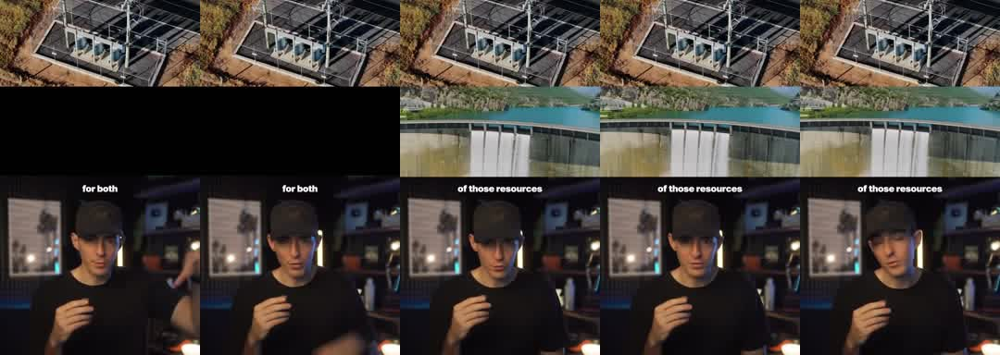

# v16_s12 · split_graphic · 17.3–18.3s (calidad 4)

- **Guion:** both of those resources,
- **Qué se ve:** La mitad superior se divide en dos tiras horizontales: subestación arriba (17,27) y presa con agua turquesa abajo (aparece en 17,77). Subtítulo «of those resources».
- **Diseño:** Pantalla dividida: evidencia arriba, él abajo en set oscuro (gorra y camiseta negras, tubo de luz cálida a la derecha, luz cian a la izquierda). Costura recta sin borde en y≈639 px de 1280 (49,9 %). Subtítulo: sans bold blanca (tipo Inter/Helvetica Now Bold) ~30 px de alto de fuente sobre 720 px de ancho, 1–3 palabras, centrado en x, sombra negra suave. Subtítulo en y≈680 px (53 %), justo bajo la costura. Arriba: gráfico diseñado: rótulo en sans EXTENDIDA ultra-bold sobre clip, render 3D, simulación o diagrama de línea azul (~#3F5FC4) sobre fondo hueso (~#E9E7E2) con trama de puntos.
- **Efectos:** Trama halftone/punteado en los diagramas; clip teñido de rojo bajo el rótulo «BLOCKED».
- **Animación:** Rótulos entran con fundido+desenfoque (~6–8 fotogramas); diagramas con paneo lateral y trazos que se dibujan; corte seco al salir.
- **Por qué aquí:** «ambos recursos» → dos imágenes simultáneas.
