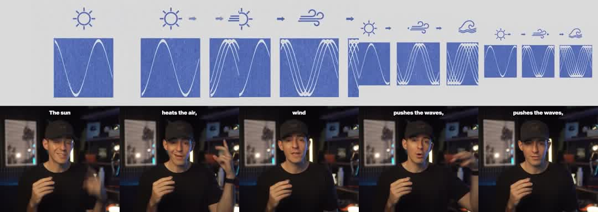

# v16_s38 · split_graphic · 66.3–70.0s (calidad 5)

- **Guion:** The sun heats the air, the air makes wind, and the wind pushes the waves.
- **Qué se ve:** Arriba diagrama sobre fondo hueso: ícono de sol → flecha → ícono de viento → flecha → ícono de ola, y bajo cada uno un mosaico azul con ondas senoidales (una, varias, muchas). La cámara panea a la derecha y luego se aleja para ver los tres. Subtítulos «The sun», «heats the air,», «the air makes», «wind», «and the wind», «pushes the waves,».
- **Diseño:** Pantalla dividida: evidencia arriba, él abajo en set oscuro (gorra y camiseta negras, tubo de luz cálida a la derecha, luz cian a la izquierda). Costura recta sin borde en y≈639 px de 1280 (49,9 %). Subtítulo: sans bold blanca (tipo Inter/Helvetica Now Bold) ~30 px de alto de fuente sobre 720 px de ancho, 1–3 palabras, centrado en x, sombra negra suave. Subtítulo en y≈680 px (53 %), justo bajo la costura. Arriba: gráfico diseñado: rótulo en sans EXTENDIDA ultra-bold sobre clip, render 3D, simulación o diagrama de línea azul (~#3F5FC4) sobre fondo hueso (~#E9E7E2) con trama de puntos.
- **Efectos:** Trama halftone/punteado en los diagramas; clip teñido de rojo bajo el rótulo «BLOCKED».
- **Animación:** Rótulos entran con fundido+desenfoque (~6–8 fotogramas); diagramas con paneo lateral y trazos que se dibujan; corte seco al salir.
- **Por qué aquí:** Cadena causal de 3 eslabones → diagrama de 3 íconos que aparece al ritmo de cada frase.
