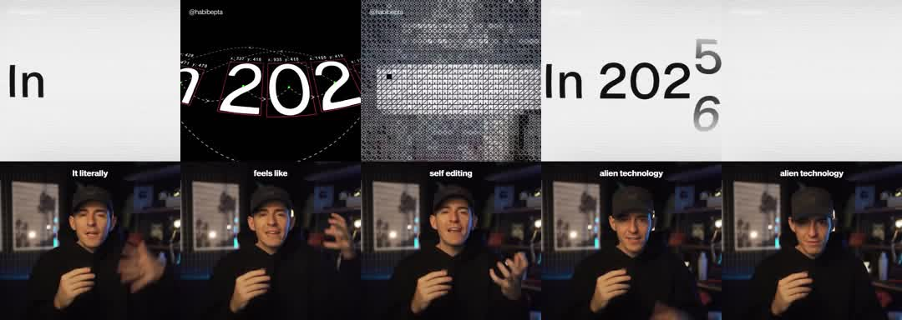

# v17_s20 · split_graphic · 37.8–40.8s (calidad 4)

- **Guion:** It literally feels like self-editing alien technology has
- **Qué se ve:** Split. Arriba tipografía cinética: fondo blanco con «In 2024/2025» (sans negra) y dígitos que ruedan como contador; alterna con fondo negro y «2025» blanco deformado en arco con puntos de tracking, y destellos de matriz de puntos/glitch. Subtítulos «feels like / self editing / alien technology».
- **Diseño:** Pantalla dividida (costura en y≈50.3% del alto): arriba motion graphic / render 3D a sangre, abajo él en plano medio. Subtítulo pequeño: sans geométrica bold (tipo Aeonik/Satoshi bold), blanco #FFFFFF, minúsculas tipo frase, ≈30 px de cuerpo sobre 720 px de ancho (bloque de 22 px de alto), centrado en X, 1–3 palabras por bloque justo bajo la costura (centro y≈54 %).
- **Efectos:** Gráfico con su propio look (fondo negro, líneas/holograma o render); sin grano añadido.
- **Animación:** Corte seco de entrada y salida; el gráfico trae su animación propia (cámara 3D, texto que entra, líneas que se dibujan).
- **Por qué aquí:** «self-editing alien technology»: no hay evidencia literal, así que usa un motion graphic raro y glitcheado para transmitir «tecnología alienígena» (metáfora por textura).
