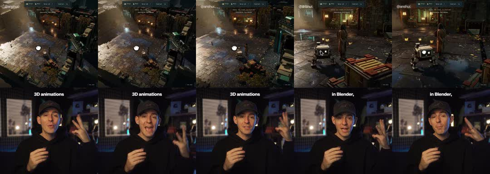

# v17_s24 · split_graphic · 45.4–47.1s (calidad 3)

- **Guion:** 3D animations in Blender,
- **Qué se ve:** Split. Arriba escena 3D nocturna (calle empedrada con cajas, robot pequeño y figura con capa) con cursor de mano. Subtítulos «3D animations / in Blender,».
- **Diseño:** Pantalla dividida (costura en y≈50.3% del alto): arriba motion graphic / render 3D a sangre, abajo él en plano medio. Subtítulo pequeño: sans geométrica bold (tipo Aeonik/Satoshi bold), blanco #FFFFFF, minúsculas tipo frase, ≈30 px de cuerpo sobre 720 px de ancho (bloque de 22 px de alto), centrado en X, 1–3 palabras por bloque justo bajo la costura (centro y≈54 %).
- **Efectos:** Gráfico con su propio look (fondo negro, líneas/holograma o render); sin grano añadido.
- **Animación:** Corte seco de entrada y salida; el gráfico trae su animación propia (cámara 3D, texto que entra, líneas que se dibujan).
- **Por qué aquí:** Ítem 3 «3D animations in Blender» → viewport 3D.
