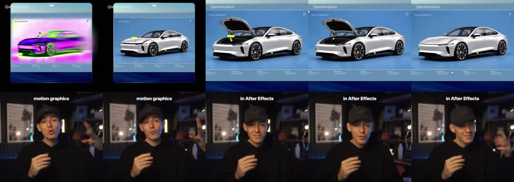

# v17_s25 · split_graphic · 47.1–48.9s (calidad 3)

- **Guion:** motion graphics and After Effects.
- **Qué se ve:** Split. Arriba tarjeta con un coche: primero pase de normales rosa/verde, luego coche blanco con capó abierto y puntos amarillos sobre fondo azul. Subtítulos «motion graphics / in After Effects».
- **Diseño:** Pantalla dividida (costura en y≈50.3% del alto): arriba motion graphic / render 3D a sangre, abajo él en plano medio. Subtítulo pequeño: sans geométrica bold (tipo Aeonik/Satoshi bold), blanco #FFFFFF, minúsculas tipo frase, ≈30 px de cuerpo sobre 720 px de ancho (bloque de 22 px de alto), centrado en X, 1–3 palabras por bloque justo bajo la costura (centro y≈54 %).
- **Efectos:** Gráfico con su propio look (fondo negro, líneas/holograma o render); sin grano añadido.
- **Animación:** Corte seco de entrada y salida; el gráfico trae su animación propia (cámara 3D, texto que entra, líneas que se dibujan).
- **Por qué aquí:** Ítem 4 «motion graphics in After Effects» → motion graphic de producto.
