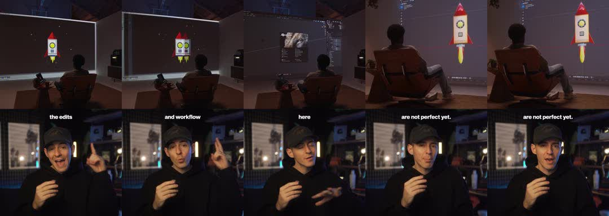

# v17_s27 · split_graphic · 50.4–52.9s (calidad 3)

- **Guion:** the edits and workflow here are not perfect yet.
- **Qué se ve:** Split. Arriba render 3D de una sala oscura con un hombre de espaldas en un sillón frente a una pantalla gigante con un cohete; luego plano más cerrado con cohete rojo sobre fondo morado. Subtítulos «the edits / and workflow / here / are not perfect yet.»
- **Diseño:** Pantalla dividida (costura en y≈50.3% del alto): arriba motion graphic / render 3D a sangre, abajo él en plano medio. Subtítulo pequeño: sans geométrica bold (tipo Aeonik/Satoshi bold), blanco #FFFFFF, minúsculas tipo frase, ≈30 px de cuerpo sobre 720 px de ancho (bloque de 22 px de alto), centrado en X, 1–3 palabras por bloque justo bajo la costura (centro y≈54 %).
- **Efectos:** Gráfico con su propio look (fondo negro, líneas/holograma o render); sin grano añadido.
- **Animación:** Corte seco de entrada y salida; el gráfico trae su animación propia (cámara 3D, texto que entra, líneas que se dibujan).
- **Por qué aquí:** Mientras admite que no es perfecto, sigue enseñando resultados generados (no baja el ritmo en la objeción).
