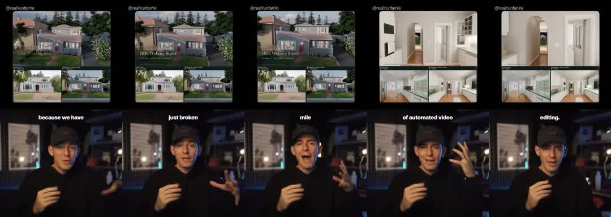

# v17_s31 · split_graphic · 58.1–62.2s (calidad 3)

- **Guion:** we have just broken the four-minute mile of automated video editing.
- **Qué se ve:** Split. Arriba, sobre negro, una ficha inmobiliaria en tarjeta: foto de casa «1836 Webster Street» con dos fotos menores debajo; a los 60.6 cambia a interiores blancos. Subtítulos «because we have / just broken / the four minute / mile / of automated video / editing.»
- **Diseño:** Pantalla dividida (costura en y≈50.3% del alto): arriba motion graphic / render 3D a sangre, abajo él en plano medio. Subtítulo pequeño: sans geométrica bold (tipo Aeonik/Satoshi bold), blanco #FFFFFF, minúsculas tipo frase, ≈30 px de cuerpo sobre 720 px de ancho (bloque de 22 px de alto), centrado en X, 1–3 palabras por bloque justo bajo la costura (centro y≈54 %).
- **Efectos:** Gráfico con su propio look (fondo negro, líneas/holograma o render); sin grano añadido.
- **Animación:** Corte seco de entrada y salida; el gráfico trae su animación propia (cámara 3D, texto que entra, líneas que se dibujan).
- **Por qué aquí:** Metáfora («four-minute mile») sin imagen literal: usa otro ejemplo de video autogenerado como fondo de prueba.
