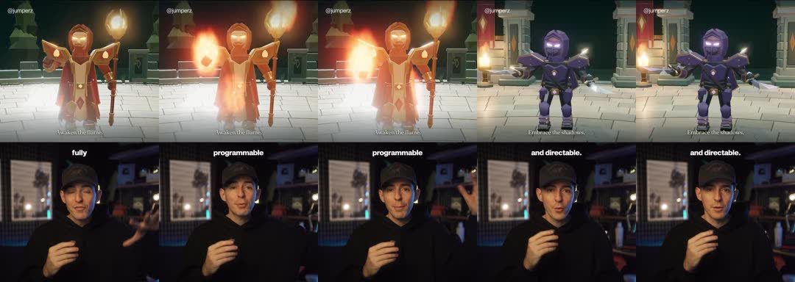

# v17_s34 · split_graphic · 65.0–67.1s (calidad 3)

- **Guion:** programmable and directable.
- **Qué se ve:** Split. Arriba personaje low-poly tipo videojuego: mago naranja con bastón y llamas («Awaken the flame.»), luego caballero morado («Embrace the shadows.»). Subtítulos «fully / programmable / and directable.»
- **Diseño:** Pantalla dividida (costura en y≈50.3% del alto): arriba motion graphic / render 3D a sangre, abajo él en plano medio. Subtítulo pequeño: sans geométrica bold (tipo Aeonik/Satoshi bold), blanco #FFFFFF, minúsculas tipo frase, ≈30 px de cuerpo sobre 720 px de ancho (bloque de 22 px de alto), centrado en X, 1–3 palabras por bloque justo bajo la costura (centro y≈54 %).
- **Efectos:** Gráfico con su propio look (fondo negro, líneas/holograma o render); sin grano añadido.
- **Animación:** Corte seco de entrada y salida; el gráfico trae su animación propia (cámara 3D, texto que entra, líneas que se dibujan).
- **Por qué aquí:** «programmable and directable» → personajes animados generados/dirigidos.
