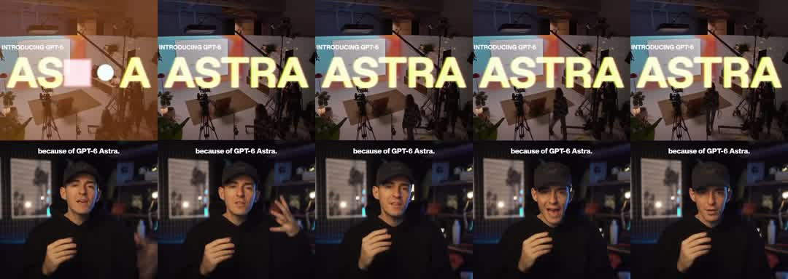

# v17_s36 · split_graphic · 68.6–70.5s (calidad 4)

- **Guion:** of GPT-6 Astra.
- **Qué se ve:** Split. Arriba, tras 1 fotograma blanco, el logo «INTRODUCING GPT-6 / ASTRA» formándose (cuadrado rosa y círculo blanco que pasan a ser letras) sobre foto de estudio. Subtítulo «because of GPT-6 Astra.»
- **Diseño:** Pantalla dividida (costura en y≈50.3% del alto): arriba motion graphic / render 3D a sangre, abajo él en plano medio. Subtítulo pequeño: sans geométrica bold (tipo Aeonik/Satoshi bold), blanco #FFFFFF, minúsculas tipo frase, ≈30 px de cuerpo sobre 720 px de ancho (bloque de 22 px de alto), centrado en X, 1–3 palabras por bloque justo bajo la costura (centro y≈54 %).
- **Efectos:** Gráfico con su propio look (fondo negro, líneas/holograma o render); sin grano añadido.
- **Animación:** Corte seco de entrada y salida; el gráfico trae su animación propia (cámara 3D, texto que entra, líneas que se dibujan). Único flash blanco del video: 1 fotograma (68.61) antes del logo.
- **Por qué aquí:** Vuelve el logo del gancho al nombrar otra vez el modelo: rima visual inicio↔final.
