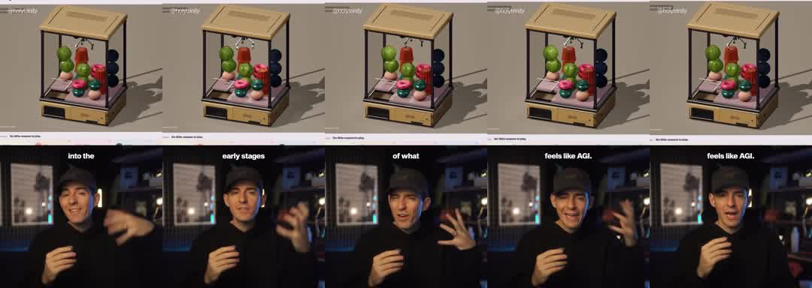

# v17_s38 · split_graphic · 72.8–75.8s (calidad 2)

- **Guion:** the early stages of what feels like AGI.
- **Qué se ve:** Split. Arriba render 3D de una máquina de gancho beige llena de juguetes de colores; pie de interfaz «Six little reasons to play.» Subtítulos «early stages / of what / feels like AGI.»
- **Diseño:** Pantalla dividida (costura en y≈50.3% del alto): arriba motion graphic / render 3D a sangre, abajo él en plano medio. Subtítulo pequeño: sans geométrica bold (tipo Aeonik/Satoshi bold), blanco #FFFFFF, minúsculas tipo frase, ≈30 px de cuerpo sobre 720 px de ancho (bloque de 22 px de alto), centrado en X, 1–3 palabras por bloque justo bajo la costura (centro y≈54 %).
- **Efectos:** Gráfico con su propio look (fondo negro, líneas/holograma o render); sin grano añadido.
- **Animación:** Corte seco de entrada y salida; el gráfico trae su animación propia (cámara 3D, texto que entra, líneas que se dibujan).
- **Por qué aquí:** Otro ejemplo generado mientras habla de AGI (relación floja: imagen de «lo que ya puede hacer»).
