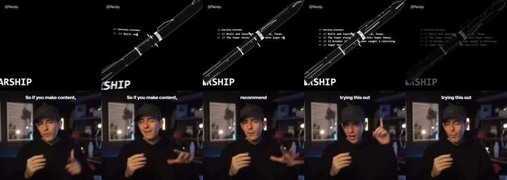

# v17_s39 · split_graphic · 75.8–78.2s (calidad 3)

- **Guion:** So if you make content, I really recommend trying this out because
- **Qué se ve:** Split. Arriba, sobre negro, cohete en wireframe blanco en diagonal con rótulo «STARSHIP» y líneas de código que se escriben («// starship.starbase», «// Built and launched…, Texas.»). Subtítulos «So if you make content, / I really / recommend / trying this out».
- **Diseño:** Pantalla dividida (costura en y≈50.3% del alto): arriba motion graphic / render 3D a sangre, abajo él en plano medio. Subtítulo pequeño: sans geométrica bold (tipo Aeonik/Satoshi bold), blanco #FFFFFF, minúsculas tipo frase, ≈30 px de cuerpo sobre 720 px de ancho (bloque de 22 px de alto), centrado en X, 1–3 palabras por bloque justo bajo la costura (centro y≈54 %).
- **Efectos:** Gráfico con su propio look (fondo negro, líneas/holograma o render); sin grano añadido.
- **Animación:** Corte seco de entrada y salida; el gráfico trae su animación propia (cámara 3D, texto que entra, líneas que se dibujan).
- **Por qué aquí:** Recomendación final con más ejemplos de motion graphics hechos por IA como fondo.
