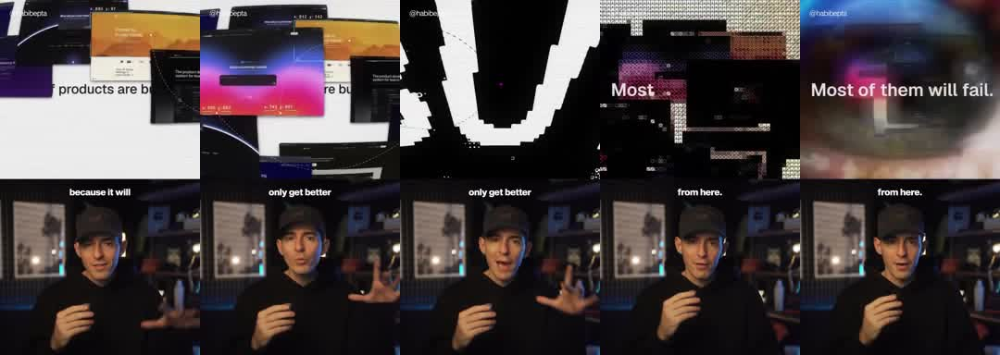

# v17_s40 · split_graphic · 78.2–80.5s (calidad 3)

- **Guion:** it will only get better and better from here.
- **Qué se ve:** Split. Arriba ráfaga final: collage de interfaces sobre blanco con «products are bu…», tarjetas con degradado rosa-azul, «BUT» en trama de semitono blanco sobre negro, y un ojo en semitono con «Most of them will fail.» Subtítulos «because it will / only get better / and better / from here.»
- **Diseño:** Pantalla dividida (costura en y≈50.3% del alto): arriba motion graphic / render 3D a sangre, abajo él en plano medio. Subtítulo pequeño: sans geométrica bold (tipo Aeonik/Satoshi bold), blanco #FFFFFF, minúsculas tipo frase, ≈30 px de cuerpo sobre 720 px de ancho (bloque de 22 px de alto), centrado en X, 1–3 palabras por bloque justo bajo la costura (centro y≈54 %).
- **Efectos:** Trama de semitono/halftone y pixelado en los gráficos de arriba (parte del material); abajo sin efectos.
- **Animación:** Corte seco de entrada y salida; el gráfico trae su animación propia (cámara 3D, texto que entra, líneas que se dibujan).
- **Por qué aquí:** Cierre sin CTA: termina con la ráfaga más rápida del video (4 gráficos en 2.4 s) para acabar arriba.
