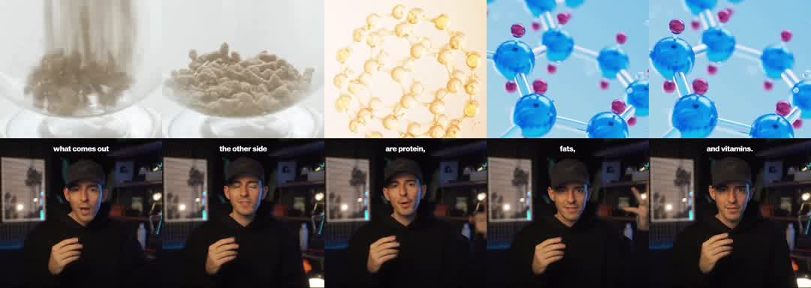

# v19_s24 · split_graphic · 48.3–51.5s (calidad 5)

- **Guion:** what comes out the other side are protein, fats, and vitamins.
- **Qué se ve:** Split. Arriba tres planos, uno por nutriente: cuenco de vidrio con grumos beige (proteína), esfera molecular dorada translúcida (grasas) y moléculas azul/magenta (vitaminas). Subtítulos «what comes out / the other side / are protein, / fats, / and vitamins.»
- **Diseño:** Pantalla dividida (costura en y≈47.9% del alto): arriba motion graphic / render 3D a sangre, abajo él en plano medio. Subtítulo pequeño: sans geométrica bold (tipo Aeonik/Satoshi bold), blanco #FFFFFF, minúsculas tipo frase, ≈30 px de cuerpo sobre 720 px de ancho (bloque de 22 px de alto), centrado en X, 1–3 palabras por bloque justo bajo la costura (centro y≈54 %).
- **Efectos:** Gráfico con su propio look (fondo negro, líneas/holograma o render); sin grano añadido.
- **Animación:** Corte seco de entrada y salida; el gráfico trae su animación propia (cámara 3D, texto que entra, líneas que se dibujan).
- **Por qué aquí:** Enumeración de 3 → 3 planos, cada corte en su palabra (protein 49.68 / fats 50.38 / vitamins 50.90).
