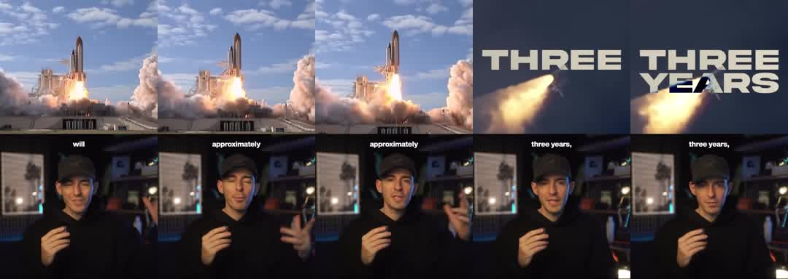

# v19_s34 · split_graphic · 72.0–74.0s (calidad 5)

- **Guion:** take approximately three years.
- **Qué se ve:** Split. Arriba despegue de un transbordador y, a los 73.2, rótulo gigante «THREE / YEARS» en beige sobre una estela de cohete en cielo azul oscuro, con la estela pasando por delante de las letras. Subtítulos «take / approximately / three years,».
- **Diseño:** Pantalla dividida (costura en y≈47.9% del alto): arriba motion graphic / render 3D a sangre, abajo él en plano medio. Subtítulo pequeño: sans geométrica bold (tipo Aeonik/Satoshi bold), blanco #FFFFFF, minúsculas tipo frase, ≈30 px de cuerpo sobre 720 px de ancho (bloque de 22 px de alto), centrado en X, 1–3 palabras por bloque justo bajo la costura (centro y≈54 %).
- **Efectos:** Gráfico con su propio look (fondo negro, líneas/holograma o render); sin grano añadido.
- **Animación:** Corte seco de entrada y salida; el gráfico trae su animación propia (cámara 3D, texto que entra, líneas que se dibujan). Rótulo: «THREE» en 73.20 (corte), «YEARS» por pop ≈0.2 s después; texto detrás de la estela (máscara).
- **Por qué aquí:** La cifra clave («three years») se convierte en rótulo gigante: dato → texto en pantalla.
