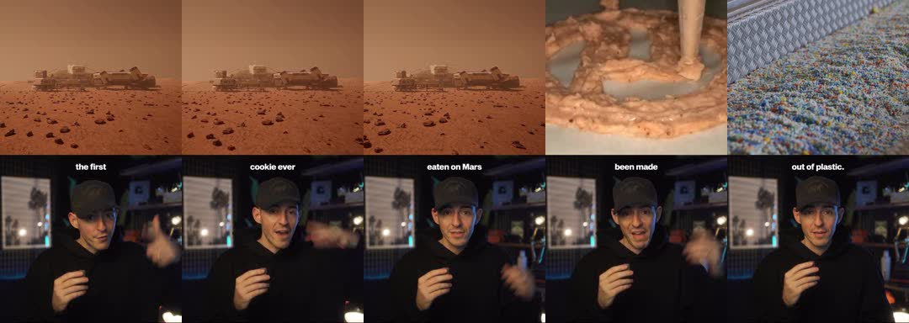

# v19_s42 · split_graphic · 91.2–95.5s (calidad 4)

- **Guion:** first cookie ever eaten on Mars will have been made out of plastic.
- **Qué se ve:** Split. Arriba render de una base/rover en un desierto marciano rojizo; luego macro de la extrusora y una cinta con granza de plástico de colores. Subtítulos «the first / cookie ever / eaten on Mars / will have / been made / out of plastic.»
- **Diseño:** Pantalla dividida (costura en y≈47.9% del alto): arriba motion graphic / render 3D a sangre, abajo él en plano medio. Subtítulo pequeño: sans geométrica bold (tipo Aeonik/Satoshi bold), blanco #FFFFFF, minúsculas tipo frase, ≈30 px de cuerpo sobre 720 px de ancho (bloque de 22 px de alto), centrado en X, 1–3 palabras por bloque justo bajo la costura (centro y≈54 %).
- **Efectos:** Gráfico con su propio look (fondo negro, líneas/holograma o render); sin grano añadido.
- **Animación:** Corte seco de entrada y salida; el gráfico trae su animación propia (cámara 3D, texto que entra, líneas que se dibujan).
- **Por qué aquí:** Cierre circular: Marte (futuro) → galleta → plástico; la última palabra «plastic» cae sobre la granza. Termina sin CTA.
