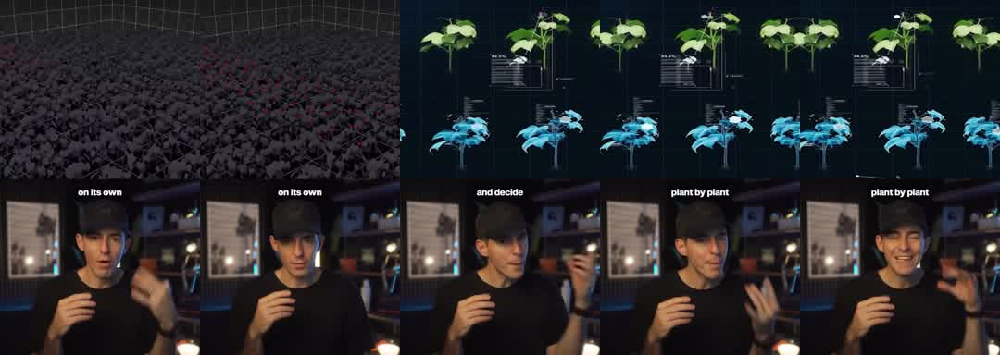

# v20_s04 · split_graphic · 7.1–9.8s (calidad 5)

- **Guion:** its own and decide plant by plant exactly
- **Qué se ve:** Split. Arriba campo 3D oscuro con puntos rojos sobre algunas plantas y luego HUD con plantas holográficas (verdes arriba, azules abajo) y paneles de datos. Subtítulos «think / on its own / and decide / plant by plant».
- **Diseño:** Pantalla dividida (costura en y≈50.3% del alto): arriba motion graphic / render 3D a sangre, abajo él en plano medio. Subtítulo pequeño: sans geométrica bold (tipo Aeonik/Satoshi bold), blanco #FFFFFF, minúsculas tipo frase, ≈30 px de cuerpo sobre 720 px de ancho (bloque de 22 px de alto), centrado en X, 1–3 palabras por bloque justo bajo la costura (centro y≈54 %).
- **Efectos:** Material del video promocional del fabricante (render 3D con rótulos en chino); se intuye re-rotulado en inglés encima. Look de holograma azul/verde sobre negro.
- **Animación:** Corte seco de entrada y salida; el gráfico trae su animación propia (cámara 3D, texto que entra, líneas que se dibujan).
- **Por qué aquí:** «think on its own… plant by plant» → visión de máquina (marcadores, HUD): hace visible el «pensar».
