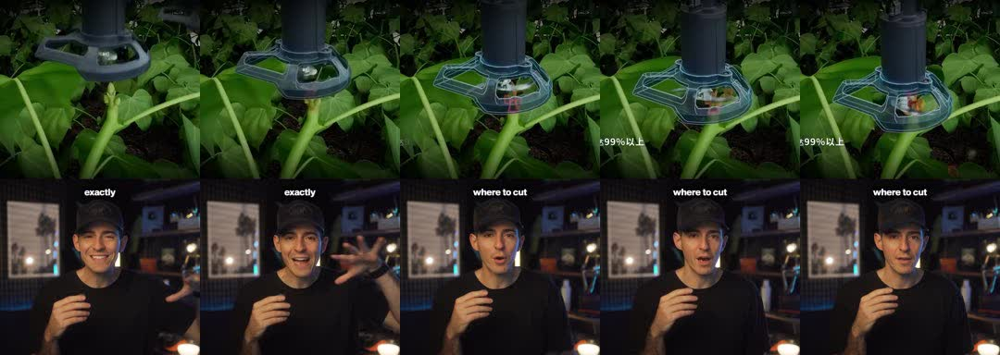

# v20_s05 · split_graphic · 9.8–11.1s (calidad 5)

- **Guion:** where to cut.
- **Qué se ve:** Split. Arriba primer plano 3D de un anillo cortador translúcido rodeando el tallo de una planta; texto chino «99%以上» abajo-izq. Subtítulos «exactly / where to cut».
- **Diseño:** Pantalla dividida (costura en y≈50.3% del alto): arriba motion graphic / render 3D a sangre, abajo él en plano medio. Subtítulo pequeño: sans geométrica bold (tipo Aeonik/Satoshi bold), blanco #FFFFFF, minúsculas tipo frase, ≈30 px de cuerpo sobre 720 px de ancho (bloque de 22 px de alto), centrado en X, 1–3 palabras por bloque justo bajo la costura (centro y≈54 %).
- **Efectos:** Material del video promocional del fabricante (render 3D con rótulos en chino); se intuye re-rotulado en inglés encima.
- **Animación:** Corte seco de entrada y salida; el gráfico trae su animación propia (cámara 3D, texto que entra, líneas que se dibujan).
- **Por qué aquí:** «exactly where to cut» → el corte en primer plano: literal.
