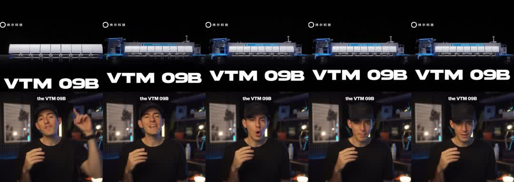

# v20_s07 · split_graphic · 11.9–13.5s (calidad 5)

- **Guion:** VTM-09B.
- **Qué se ve:** Split. Arriba la máquina completa de perfil sobre negro con logo chino «纬尔科技» y rótulo grande blanco «VTM 09B». Subtítulo «the VTM 09B».
- **Diseño:** Pantalla dividida (costura en y≈50.3% del alto): arriba motion graphic / render 3D a sangre, abajo él en plano medio. Subtítulo pequeño: sans geométrica bold (tipo Aeonik/Satoshi bold), blanco #FFFFFF, minúsculas tipo frase, ≈30 px de cuerpo sobre 720 px de ancho (bloque de 22 px de alto), centrado en X, 1–3 palabras por bloque justo bajo la costura (centro y≈54 %).
- **Efectos:** Material del video promocional del fabricante (render 3D con rótulos en chino); se intuye re-rotulado en inglés encima.
- **Animación:** Corte seco de entrada y salida; el gráfico trae su animación propia (cámara 3D, texto que entra, líneas que se dibujan). Rótulo: aparece desplazado a la izquierda y más grande, se asienta centrado en ≈6 fotogramas (0.25 s).
- **Por qué aquí:** Nombre del producto → rótulo gigante con el nombre (regla «nombre propio = texto»).
