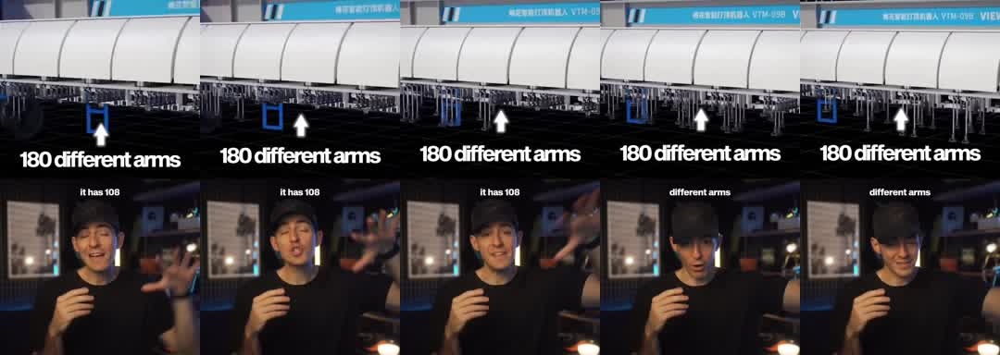

# v20_s08 · split_graphic · 13.5–15.2s (calidad 4)

- **Guion:** It has 108 different arms and
- **Qué se ve:** Split. Arriba la parte baja de la máquina con una flecha blanca y el texto «180 different arms» (él dice «108»). Subtítulos «it has 108 / different arms».
- **Diseño:** Pantalla dividida (costura en y≈50.3% del alto): arriba motion graphic / render 3D a sangre, abajo él en plano medio. Subtítulo pequeño: sans geométrica bold (tipo Aeonik/Satoshi bold), blanco #FFFFFF, minúsculas tipo frase, ≈30 px de cuerpo sobre 720 px de ancho (bloque de 22 px de alto), centrado en X, 1–3 palabras por bloque justo bajo la costura (centro y≈54 %).
- **Efectos:** Material del video promocional del fabricante (render 3D con rótulos en chino); se intuye re-rotulado en inglés encima.
- **Animación:** Corte seco de entrada y salida; el gráfico trae su animación propia (cámara 3D, texto que entra, líneas que se dibujan).
- **Por qué aquí:** Dato técnico → cifra escrita sobre la pieza señalada con flecha. Ojo: el rótulo dice 180 y la voz/subtítulo 108 (error de rotulado observado).
