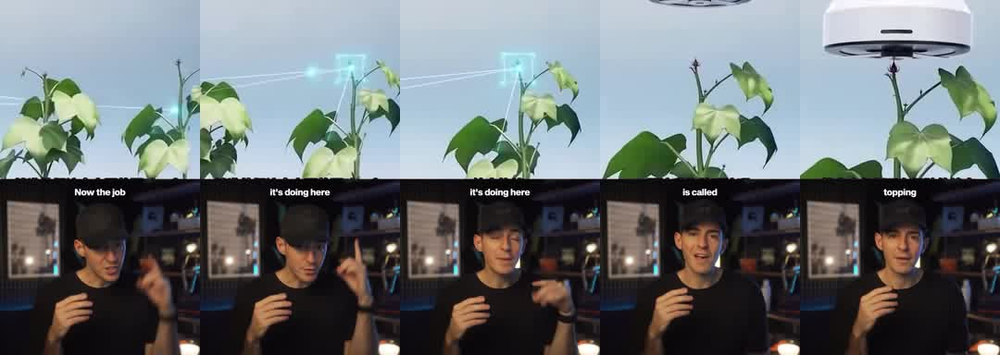

# v20_s10 · split_graphic · 17.5–19.5s (calidad 3)

- **Guion:** Now the job it's doing here is called topping.
- **Qué se ve:** Split. Arriba planta 3D con líneas láser turquesa que marcan el brote superior y luego el disco blanco sobre la punta. Subtítulos «Now the job / it's doing here / is called / topping».
- **Diseño:** Pantalla dividida (costura en y≈50.3% del alto): arriba motion graphic / render 3D a sangre, abajo él en plano medio. Subtítulo pequeño: sans geométrica bold (tipo Aeonik/Satoshi bold), blanco #FFFFFF, minúsculas tipo frase, ≈30 px de cuerpo sobre 720 px de ancho (bloque de 22 px de alto), centrado en X, 1–3 palabras por bloque justo bajo la costura (centro y≈54 %).
- **Efectos:** Material del video promocional del fabricante (render 3D con rótulos en chino); se intuye re-rotulado en inglés encima.
- **Animación:** Corte seco de entrada y salida; el gráfico trae su animación propia (cámara 3D, texto que entra, líneas que se dibujan).
- **Por qué aquí:** Define el término («topping») mostrando exactamente qué parte se corta.
