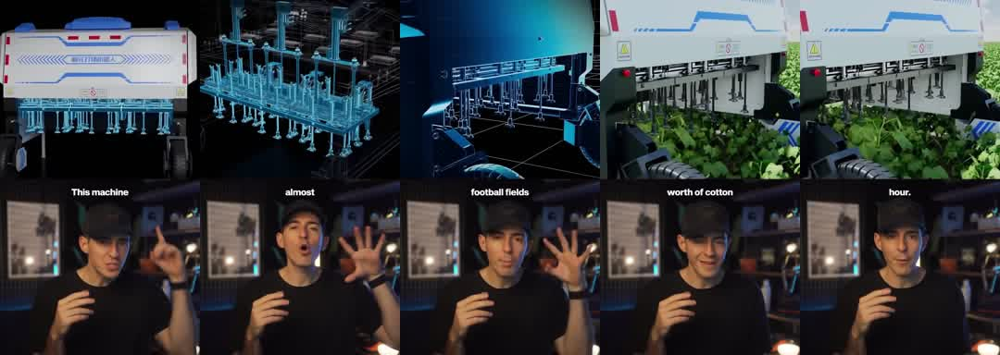

# v20_s32 · split_graphic · 61.4–66.0s (calidad 3)

- **Guion:** This machine can clear almost four football fields worth of cotton in a single hour.
- **Qué se ve:** Split. Arriba frontal de la máquina con sus brazos, estructura en rayos X azul y los brazos pasando sobre el cultivo. Subtítulos «This machine / can clear / almost / four / football fields / worth of cotton / in a single / hour.»
- **Diseño:** Pantalla dividida (costura en y≈50.3% del alto): arriba motion graphic / render 3D a sangre, abajo él en plano medio. Subtítulo pequeño: sans geométrica bold (tipo Aeonik/Satoshi bold), blanco #FFFFFF, minúsculas tipo frase, ≈30 px de cuerpo sobre 720 px de ancho (bloque de 22 px de alto), centrado en X, 1–3 palabras por bloque justo bajo la costura (centro y≈54 %).
- **Efectos:** Material del video promocional del fabricante (render 3D con rótulos en chino); se intuye re-rotulado en inglés encima.
- **Animación:** Corte seco de entrada y salida; el gráfico trae su animación propia (cámara 3D, texto que entra, líneas que se dibujan).
- **Por qué aquí:** Dato de capacidad sobre la máquina trabajando (sin rótulo de cifra aquí).
